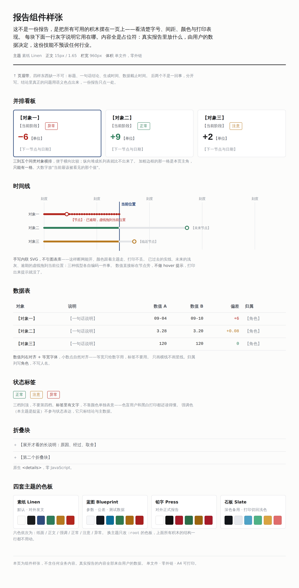

# diva-report-skill

让 AI Agent 交出来的那份网页报告，从「能看」变成**「不用再排版就能直接发出去」**。

一个 Agent Skill（`SKILL.md` 格式，Claude Code / Codex / 自建 Agent 通用）。
给的是**报告骨架 + 视觉纪律 + 技术契约 + 四套主题**，不是一个要安装的程序——没有依赖，没有构建步骤，没有脚本要跑。



> 上图是 `examples/specimen.html`——**组件样张，不是报告**：把所有积木摆在一页上看样式，内容全是占位符。
> 单文件，断网双击能开，Ctrl+P 直接出 A4。

## 为什么又造一个

同类技能大多是**深色**的（PicoCSS 深色、Dracula、Tokyo Night……）。在企业里这有两个现实问题：

1. 深色报告转发给主管或客户，经常被当成"不够正式"；
2. 打印出来要么糊成一片，要么整页吃墨。

所以这套**浅色优先**：三套浅色主题（商务 / 工程 / 杂志）+ 一套深色备用，且每一套都先满足"打印出来能开会"。

## 五条硬约束

| | |
|---|---|
| **单文件** | 一个 `.html` 就是全部，CSS 内联、SVG 内联、图片转 data URI |
| **零外链** | 没有 CDN、没有 Google Fonts、没有图表库。**断网双击能打开**是验收标准 |
| **能打印** | A4 纵向，表格不跨页断裂，背景色保留，折叠块自动摊开 |
| **尽量零 JS** | 折叠用原生 `<details>`，脚本挂掉页面内容仍完整 |
| **浅色优先** | 深色是备用档，且打印时强制切回浅色 |

要图表就手写内联 SVG。几十行能画出柱状、时间线、环形，还能跟着主题变量走色——比引一个 200 KB 的图表库更可控，也不会一断网就白屏。

## 内容

```
SKILL.md                      技能主体：什么时候用、三步走、落盘约定
references/
  report-types.md             六类报告的骨架（完工/调研/审查/受阻/对比/进度）
  visual-rules.md             视觉纪律 + 反「AI 味」清单 + 交付前自查清单
  html-contract.md            单文件/零外链/打印/无障碍契约，含可直接抄的 CSS 骨架
themes/
  _spec.md                    主题怎么写（11 个变量，缺一个就会有人临时编颜色）
  linen.md                    素纸 · 克制商务 · 浅色（默认）
  blueprint.md                蓝图 · 工程技术 · 浅色
  press.md                    铅字 · 编辑杂志 · 浅色
  slate.md                    石板 · 深色备用
examples/specimen.html        组件样张：所有积木的样式与打印表现（无业务内容）
```

## 用法

**Claude Code / 任何读 `SKILL.md` 的 Agent**：把本仓库放进技能目录即可。

```bash
git clone https://github.com/KanbaraKenji/diva-report-skill ~/.claude/skills/diva-report-skill
```

**DIVA**：作为一个插件装入，`plugin.md` 里声明 `provides.prompts` / `provides.templates`；
启用即把报告写法拼进系统提示，停用即抹。

**其他 Agent**：把 `SKILL.md` 连同 `references/` 的三份一起喂进系统提示，或让 Agent 按需读取。

## 它不预设任何业务

这是一份**风格与结构**的指导文件，不是模板库。技能里没有任何行业、部门、产品或人名——
报告里的每一个字都来自使用者自己的数据，连字段怎么称呼都用使用者的叫法。
所以同一份技能，做模具开发周报、做安全审计、做供应商对比，出来的都是对的。

## 换一套主题 / 换一家公司

改 `themes/` 下的一个文件就够了，骨架和纪律不动。
用户有品牌色时，**只覆盖 `--accent` 一项**，灰阶别动——灰阶是按对比度算好的。

## 思路来源

骨架与纪律来自几份公开工作，**逐条记在 [CREDITS.md](CREDITS.md)**：
Anthropic 官方的 `frontend-design`（反 AI 味清单）与 `theme-factory`（主题写法）、
[claude-report-skill](https://github.com/MarcinDudekDev/claude-report-skill)（按类型给骨架）、
[visual-explainer](https://github.com/nicobailon/visual-explainer)（单文件零 CDN 路线）、
[claude-design-skill](https://github.com/jiji262/claude-design-skill)（先定方向再写代码）。

本仓库的文字、色板、CSS 骨架与样例报告为原创编写，未逐字复制上述任何一份。

## 许可证

MIT。
